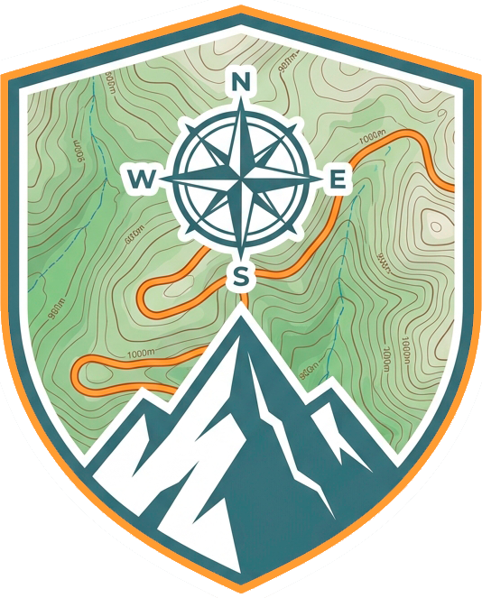
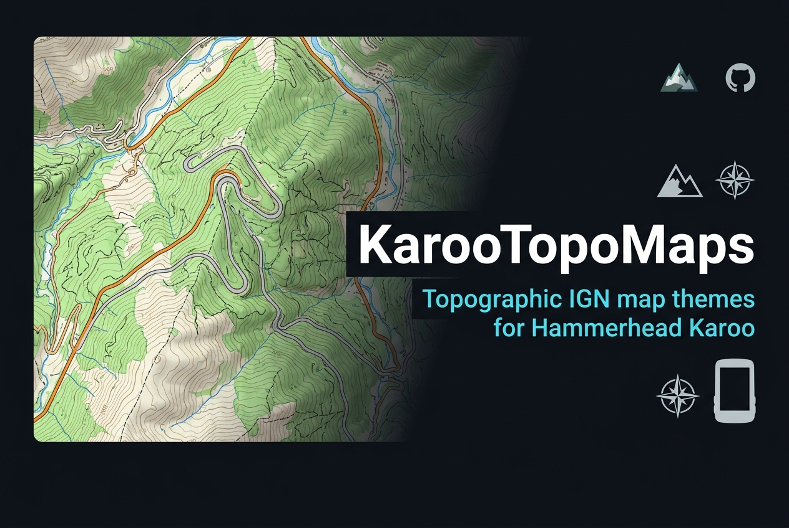

# 🗺️ KarooTopoMaps

> **Premium-Kartenkollektion und Begleit-App für Hammerhead Karoo Radcomputer (1, 2 und Karoo 3)**  
> *Verwandle die native Karte deines Fahrradcomputers in professionelle, kontrastreiche topografische Karten.*

<p align="center">
  
</p>

<p align="center">
  
</p>

<p align="center">
  <a href="README.md">🇪🇸 Español</a> |
  <a href="README_en.md">🇬🇧 English</a> |
  <a href="README_fr.md">🇫🇷 Français</a> |
  <a href="README_de.md">🇩🇪 Deutsch</a> |
  <a href="README_it.md">🇮🇹 Italiano</a> |
  <a href="README_pt.md">🇵🇹 Português</a>
</p>

<p align="center">
  <a href="https://github.com/DAVOE75/KarooTopoMaps/releases/latest"></a>
  <a href="https://buymeacoffee.com/davoe75"></a>
</p>

---

## 🎨 Theme-Katalog

* **🗺️ IGN**: Offizieller spanischer 1:25.000 Topo-Kartenstil mit Höhenlinien und klarem Relief.
* **📜 Vintage-Entdecker**: Kupferstich-Lithografie des 19. Jahrhunderts in reinem Sepia.
* **🪨 Erde & Schotter**: Organischer Gravel-Stil in warmem Weiß und Schokoladenbraun.
* **🌈 Technologisch / DHM**: Hypsometrische Heatmap für Pässe und Bergetappen.
* **🌲 Trail-Revier**: Dichte Kiefernwälder und Farbcodierung für MTB-Singletrails (S0-S5).
* **🏔️ Granit-Hochland**: Skandinavisch-mineralischer Minimalismus in Schiefergrau und Eisblau.
* **🕶️ Taktischer Nachtmodus**: Mattes Kohlegrau ohne grelle Farben zur Schonung der Augen.
* **🚵 Elevate MTB**: Klassischer Alpenstil mit vollständiger Wandermarkierung.
* **⚡ ALT-MTB Spezial**: Maximaler optischer Kontrast für grelles Sommer-Sonnenlicht.

---

## 📲 Installation

APK [`release/KarooTopoMaps-v1.0.0.apk`](release/KarooTopoMaps-v1.0.0.apk) via ADB installieren:

```bash
adb install -r KarooTopoMaps-v1.0.0.apk
```
