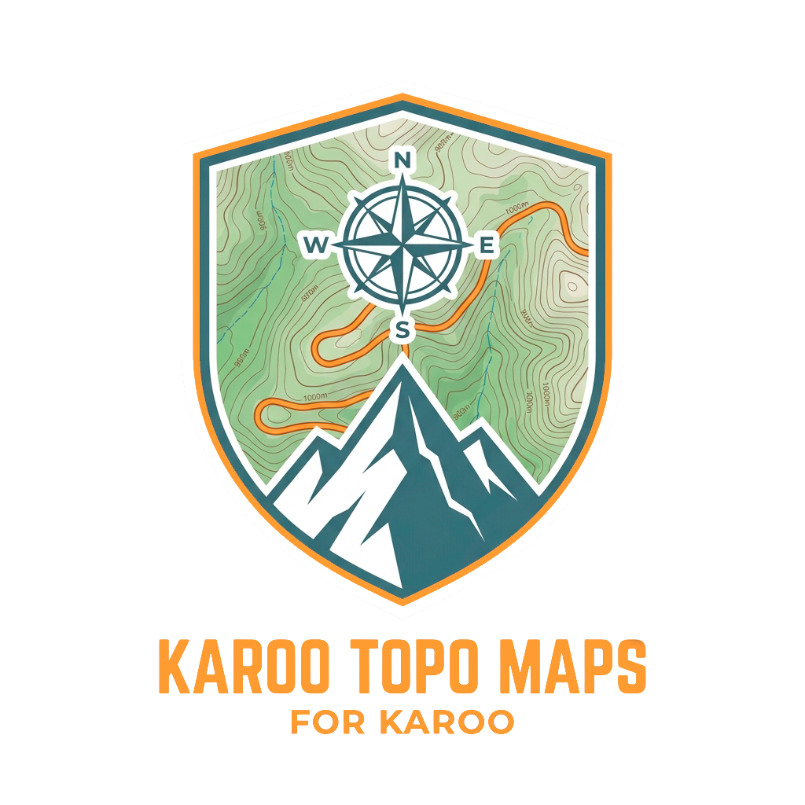
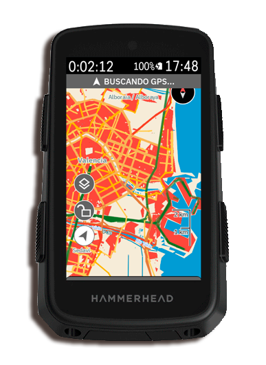
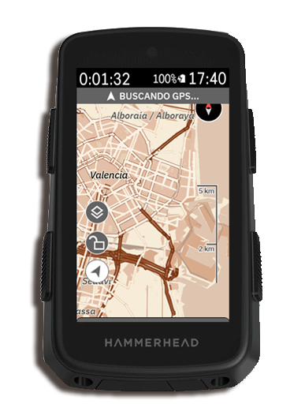
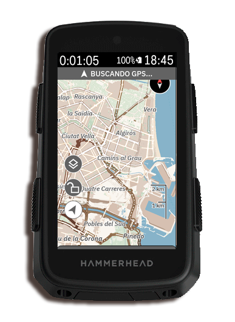
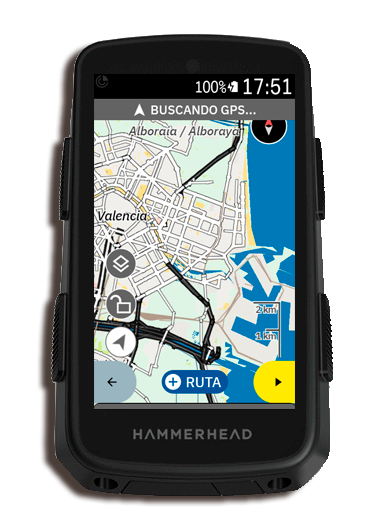
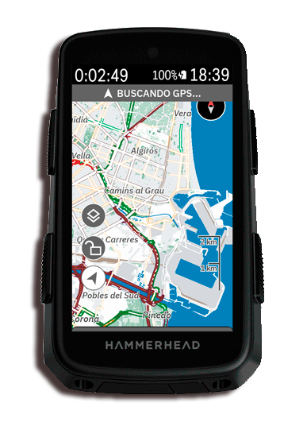
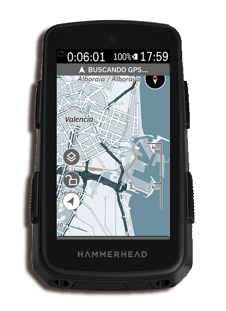
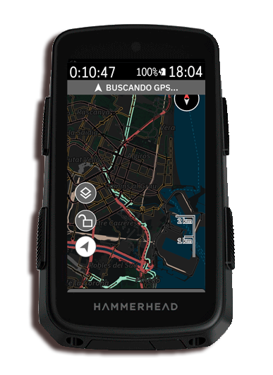
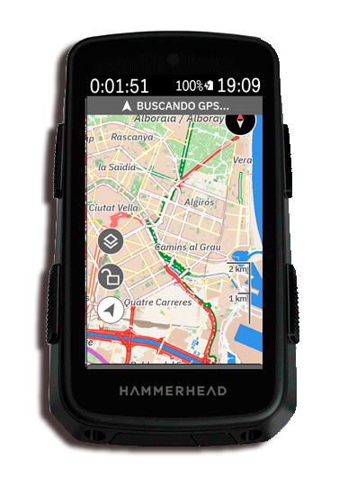
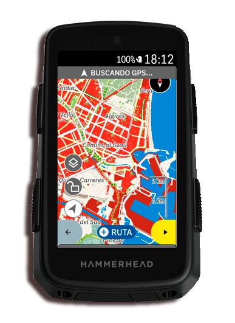

# KarooTopoMaps

> **Collection Cartographique Premium et Application pour compteurs Hammerhead Karoo (1, 2 et Karoo 3)**  
> *Transformez la carte native de votre GPS avec des styles topographiques professionnels à haut contraste.*

<p align="center">
  
</p>

<p align="center">
  <a href="README.md">Español</a> |
  <a href="README_en.md">English</a> |
  <a href="README_fr.md">Français</a> |
  <a href="README_de.md">Deutsch</a> |
  <a href="README_it.md">Italiano</a> |
  <a href="README_pt.md">Português</a>
</p>

<p align="center">
  <a href="https://github.com/DAVOE75/KarooTopoMaps/releases/latest"></a>
  <a href="https://github.com/DAVOE75/KarooTopoMaps/releases"></a>
  
  <a href="https://github.com/DAVOE75/KarooTopoMaps/blob/main/LICENSE"></a>
  <a href="https://buymeacoffee.com/davoe75"></a>
</p>

---

## Qu'est-ce que KarooTopoMaps

**KarooTopoMaps** est une suite cartographique artisanale et une application Android conçue spécifiquement pour les cyclistes exigeants. Elle remplace la carte standard de votre Hammerhead Karoo par **9 styles cartographiques professionnels radicalement différenciés**.

Chaque thème a été calibré avec précision pour les écrans transflectifs du Karoo sous la lumière directe du soleil, garantissant une lisibilité maximale des sentiers, des courbes de niveau et un contraste parfait avec le tracé de votre parcours.

---

## Galerie sur Appareil Réel (Hammerhead Karoo)

<table align="center">
  <tr>
    <td align="center" width="33%">
      <br>
      <b>IGN Officiel</b><br>
      <i>Carte topographique classique 1:25 000 avec courbes et parcelles nettes</i>
    </td>
    <td align="center" width="33%">
      <br>
      <b>Explorateur Vintage</b><br>
      <i>Gravure du XIXe siècle en sépia monochrome sans couleurs modernes</i>
    </td>
    <td align="center" width="33%">
      <br>
      <b>Terre &amp; Gravier</b><br>
      <i>Gravel alpin : pistes chocolat foncé et courbes couleur sable</i>
    </td>
  </tr>
  <tr>
    <td align="center" width="33%">
      <br>
      <b>Technologique / MNE</b><br>
      <i>Carte thermique hypsométrique continue avec sentiers noirs nets</i>
    </td>
    <td align="center" width="33%">
      <br>
      <b>Territoire Trail</b><br>
      <i>Forêts de pins denses, sentiers pourpres et cotation technique VTT OSM</i>
    </td>
    <td align="center" width="33%">
      <br>
      <b>Granit Altiplano</b><br>
      <i>Minimalisme nordique en ardoise, asphalte froid et eau bleu glacier</i>
    </td>
  </tr>
  <tr>
    <td align="center" width="33%">
      <br>
      <b>Mode Nuit Tactique</b><br>
      <i>Noir carbone mat antireflet avec chemins blancs sans teintes néon</i>
    </td>
    <td align="center" width="33%">
      <br>
      <b>Elevate VTT</b><br>
      <i>Style alpin européen traditionnel avec sentiers marron montagne</i>
    </td>
    <td align="center" width="33%">
      <br>
      <b>ALT-VTT Spécial</b><br>
      <i>Contraste optique extrême pour lecture sous plein soleil d'été</i>
    </td>
  </tr>
</table>

---

## Comparatif des Thèmes

| Thème | Identité Cartographique | Idéal pour |
|---|---|---|
| **IGN** | Cartographie officielle 1:25 000 de l'IGN espagnol (MTN25) : courbes de niveau maîtresses et secondaires nettes, cadastre parcellaire détaillé, hydrographie officielle et lisibilité optimale au soleil. | Exploration générale, randonnée, grands cols routiers et cyclisme en Espagne. |
| **Explorateur Vintage** | Monochrome sépia façon gravure sur cuivre du XIXe siècle. 0 % de couleurs modernes : le tracé rouge de votre itinéraire ressort avec une clarté absolue. | Gravel vintage, cyclotourisme et épreuves classiques. |
| **Terre &amp; Gravier** | Esthétique alpine organique : fond blanc cassé réfléchissant, distinction granulaire du revêtement et des pistes (grade 1 à 5 : goudron, gravier compacté, terre, chemins d'exploitation). | Pistes forestières, bikepacking, gravel technique et transitions de revêtement. |
| **Technologique / MNE** | Modèle numérique d'élévation avec heatmap hypsométrique continue (vallées vertes, moyenne montagne ambre, sommets terre cuite) et sentiers noirs à halo blanc. | Cols de montagne, profil d'élévation et dénivelé continu. |
| **Territoire Trail** | Forêt de pins dense, sentiers violet mûre ultra-visibles et cotation technique VTT OSM (S0-S5). | Enduro, All-Mountain et sous-bois techniques. |
| **Granit Altiplano** | Minimalisme minéral scandinave : échelle de gris ardoise froide, lacs bleu glacier et mise en valeur des réseaux cyclables officiels (EuroVelo / ICN, NCN, RCN) sur asphalte propre. | Cyclisme sur route alpin, véloroutes et esthétique pure. |
| **Mode Nuit Tactique** | Noir carbone mat antireflet sans néons criards. Chemins blancs lisibles, repos visuel total et consommation batterie réduite. | Sorties nocturnes, aube et entraînements d'hiver. |
| **Elevate VTT** | Style alpin traditionnel d'Europe centrale (type SwissTopo / Kompass) avec balisage complet et sentiers marron montagnard. | Randonnée alpine en haute altitude et VTT traditionnel. |
| **ALT-VTT Spécial** | Variante à très haut contraste optique avec bordures saturées pour une lisibilité parfaite sous le soleil zénithal d'été. | Fort ensoleillement estival et réverbération intense. |

---

## Installation de l'Application

Le moyen le plus simple de changer de thème directement depuis l'écran de votre Karoo :

1. **Téléchargez l'APK** : Téléchargez la dernière version [`KarooTopoMaps-v1.2.2.apk`](release/KarooTopoMaps-v1.2.2.apk) ou depuis la section [Releases](https://github.com/DAVOE75/KarooTopoMaps/releases).
2. **Installez sur votre Karoo** :
   ```bash
   adb install -r KarooTopoMaps-v1.2.2.apk
   ```
3. **Lancez KarooTopoMaps** : Ouvrez l'application sur votre Karoo, appuyez sur **"Appliquer au Karoo"** sur le thème de votre choix, ouvrez l'application **Ride** et profitez !

---

## Origine Cartographique et Crédits

* **Thème IGN Officiel** : Ce style cartographique a été créé de manière 100 % artisanale et indépendante par David García Pascual (hesiOX), en s'inspirant fidèlement de la sémiologie et de la charte graphique de la **Carte Topographique Nationale MTN25 (échelle 1:25 000)** de **l'Instituto Geográfico Nacional d'Espagne (IGN / CNIG)**. En aucun cas le thème Elevate de Tobias Kuehn n'a été consulté, utilisé ou copié, et aucun pack externe d'icônes (`ele-res`) n'est requis. Il s'agit d'un style vectoriel Mapsforge pur et autonome.
* **Licence** : [MIT License](LICENSE).

---

## Soutenir le Projet

La conception, le calibrage et les tests sur le terrain sous le soleil nécessitent d'innombrables heures de travail. Si vous appréciez ces cartes lors de vos sorties, vous pouvez soutenir le projet :

<p align="center">
  <a href="https://buymeacoffee.com/davoe75"></a>
</p>
